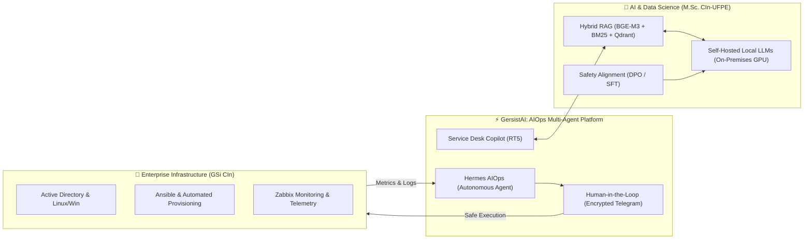

# Pedro Victor Lima Barbosa
### Computer Scientist | IT Infrastructure Analyst | AI & Data Science Researcher

  
  
  
  

---

> [!NOTE]
> **Bridging Enterprise Systems & Cutting-Edge AI:** Graduated in Computer Science from **CIn - UFPE**, working as an **IT Infrastructure Analyst (GSi - CIn/UFPE)** and researching **AIOps, Local LLMs, and Multi-Agent Architectures (GersistAI)** as a Master's Candidate at CIn - UFPE.

---

## 👨‍💻 About Me / Sobre Mim

<b>🇺🇸 English Overview</b>

 

- 🎓 **Academic Background**: B.Sc. in Computer Science from **Centro de Informática (CIn) - UFPE** — top-tier computing institute in Latin America.
- 🔬 **Current Research (M.Sc. Candidate @ CIn-UFPE)**: Focused on **Artificial Intelligence for IT Operations (AIOps)**, on-premises Local LLM inference, Hybrid Retrieval-Augmented Generation (RAG with Qdrant + BM25 + Cross-Encoders), Human-in-the-Loop (HITL) orchestration, and Direct Preference Optimization (DPO).
- 💼 **Professional Role**: IT Infrastructure Analyst at **Gerência de Sistemas (GSi - CIn/UFPE)**, managing mission-critical enterprise environments, Active Directory, server clusters (Linux/Windows), high-availability networking, and automation.
- 🏛️ **Academic Experience**: Former Undergraduate Researcher at **GPRT** (Networking and Telecommunications Research Group - CIn/UFPE) and 24 months of academic teaching assistantship (Monitoria).
- 🔭 **Featured Project**: Designing and building **GersistAI** — an on-premises multi-agent platform combining autonomous agents (`Hermes AIOps`), ticket service desk copilots (`Request Tracker 5`), and local models aligned for zero-risk IT operations.
- 💬 **Ask me about**: Linux/Windows Administration, Ansible automation, Hybrid RAG, Multi-Agent systems, LangChain, and Enterprise Network Infrastructure.

<b>🇧🇷 Resumo em Português</b>

 

- 🎓 **Formação Acadêmica**: Bacharel em Ciência da Computação pelo **Centro de Informática (CIn) da UFPE**.
- 🔬 **Pesquisa e Mestrado (CIn-UFPE)**: Candidato ao Mestrado com pesquisa em **AIOps (Inteligência Artificial para Operações de TI)**, inferência local de LLMs (*self-hosted* on-premises), RAG híbrido (Qdrant + BM25 + Cross-Encoder), alinhamento via DPO/SFT e validação humana obrigatória (*Human-in-the-Loop*).
- 💼 **Atuação Profissional**: Analista de Infraestrutura em TI na **Gerência de Sistemas (GSi / GerSIST - CIn/UFPE)**, administrando servidores críticos Linux e Windows Server, Active Directory, automação de provisionamento e infraestrutura de redes.
- 🏛️ **Trajetória Acadêmica**: Pesquisador de Iniciação Científica no **GPRT** (Grupo de Pesquisa em Redes e Telecomunicações) e 24 meses de monitoria acadêmica no CIn-UFPE.
- 🔭 **Projeto em Destaque**: Autor da arquitetura do **GersistAI** — ecossistema multiagente seguro e privado para automação de ITSM/AIOps no CIn-UFPE.
- 💬 **Converse comigo sobre**: Automação com Ansible/PowerShell/Bash, arquitetura de sistemas AIOps, modelos locais de IA, governança de redes e banco de dados corporativo.

---

## 🧭 System Architecture & Research Focus

---

## 🛠️ Technical Stack & Skills

<table>
  <tr>
    <td width="22%"><b>🤖 AI, LLMs & Agents</b></td>
    <td>
      
      
      
      
      
      
      
      
      
    </td>
  </tr>
  <tr>
    <td><b>☁️ DevOps & Infrastructure</b></td>
    <td>
      
      
      
      
      
      
      
      
      
      
    </td>
  </tr>
  <tr>
    <td><b>⚡ Scripting & Automation</b></td>
    <td>
      
      
      
      
    </td>
  </tr>
  <tr>
    <td><b>💻 Backend & Systems</b></td>
    <td>
      
      
      
      
      
    </td>
  </tr>
  <tr>
    <td><b>💾 Databases & Modeling</b></td>
    <td>
      
      
      
      
    </td>
  </tr>
</table>

---

## 🚀 Featured Projects & Academic Highlights

| Project | Domain | Description | Technologies |
| :--- | :--- | :--- | :--- |
| **[GersistAI](https://cin.ufpe.br)** *(Mestrado CIn)* | `AIOps` • `LLMs` | Private on-premises multi-agent AIOps platform with Hybrid RAG, HITL execution & local model alignment. | `Local LLMs` `RAG` `Qdrant` `Zabbix` `RT5` `DPO` |
| **[DebateAI](https://github.com/PedrovlBarbosa/DebateAI)** | `GenAI` • `NLP` | Autonomous argumentation and multimodal debate engine powered by LLMs and generative pipelines. | `FastAPI` `LangChain` `PyTorch` `Diffusers` `OpenAI` |
| **[ansibl](https://github.com/PedrovlBarbosa/ansibl)** | `IaC` • `SysAdmin` | Enterprise playbooks for automated Linux domain joining (AD/SSO) and standardized OS image provisioning. | `Ansible` `Shell` `PowerShell` `Active Directory` |
| **[Battle-Criatividade](https://github.com/PedrovlBarbosa/Battle-Criatividade)** | `Full Stack` • `AI` | Interactive web platform with FastAPI backend for creative challenges and automated evaluation. | `Python` `FastAPI` `JavaScript` `REST` |
| **[Projeto-IF685](https://github.com/PedrovlBarbosa/Projeto-IF685-2022)** | `Databases` | Full-cycle database architecture: EER conceptual, relational normalization, PL/SQL & NoSQL MongoDB. | `Oracle SQL` `PL/SQL` `MongoDB` `Data Modeling` |
| **[RPNStacker](https://github.com/PedrovlBarbosa/RPNStackerPostfix-IDexpression)** | `Compilers` | Compiler theory implementation featuring automated regex scanning, tokenizers, and postfix evaluation. | `Java` `Automata` `Lexical Analysis` |
| **[DatavizAR](https://github.com/PedrovlBarbosa/DatavizAR)** | `AR` • `Multimedia` | Augmented reality data visualization interface developed at CIn-UFPE. | `Java` `Augmented Reality` `Data Viz` |

---

## 📊 GitHub Analytics

  
  

  

---

## 🤝 Connect With Me / Onde Me Encontrar

  
  &nbsp;&nbsp;
  
  &nbsp;&nbsp;
  

  Centro de Informática (CIn) — Universidade Federal de Pernambuco (UFPE)

